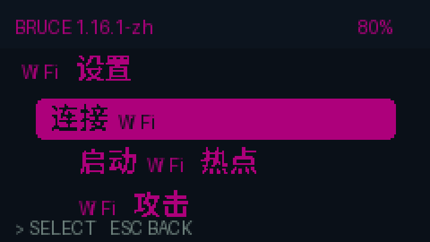

# Bruce 固件 · M5Stack Cardputer 简体中文版

[](https://github.com/sunshinexk/Bruce-Cardputer-zh/actions/workflows/build-zh.yml)

> **本项目是 [BruceDevices/firmware](https://github.com/BruceDevices/firmware) 的第三方简体中文汉化，非官方项目。**
>
> 原版 Bruce 固件及其全部功能的版权归 **BruceDevices 与 Bruce 贡献者**所有，遵循 **GPL-3.0**。本仓库只新增中文语言层、内嵌中文字库、少量排版/构建修正和预编译固件；上游英文说明保留在 [`README_upstream.md`](README_upstream.md)。

基于 [Bruce](https://github.com/BruceDevices/firmware) 开源固件制作的 **M5Stack Cardputer 简体中文版**。

在原版全部功能的基础上，加入了一套轻量的中文语言层和内嵌中文点阵字体；不依赖 SD 卡、不修改分区表，刷入后即可显示中文菜单。



> 上图为使用固件内嵌字库生成的界面示意，实际显示以设备为准。

> ⚠️ 本项目仅供安全研究、授权渗透测试与自有设备学习使用。请遵守当地法律法规，勿用于未经授权的设备或网络。

---

## 特性

- **中文界面**：主菜单、设置、WiFi / 蓝牙 / RFID / 红外 / 射频 / 文件 / 时钟等主要菜单与常用提示已汉化，WiFi、NFC、RF、FM 等常用英文称呼保留。
- **内嵌中文字体**：12px / 16px 两级 1bpp 点阵字库（GB2312 全集 + 翻译用字），无需外置字库文件。
- **混合排版**：中英文、数字、全角标点混排；菜单标题与长文本会按像素宽度自动截断、换行，不再出现半个汉字。
- **可维护的翻译表**：所有译文集中在 [`lang/zh_CN.json`](lang/zh_CN.json)，改完运行 `tools/gen_zh_lang.py` 即可重新生成固件内的字符串表。
- **未翻译内容安全回退**：词典里没有的字符串仍按原版英文显示，不会乱码。
- **与原版一致的构建方式**：PlatformIO + Arduino-ESP32，一条命令即可编译。

## 版本

- 固件版本号：`1.16.1-zh`
- 基于上游 `firmware-main`（2026-10 快照）
- 目标设备：**M5Stack Cardputer**（ESP32-S3，8MB Flash）
- 分区表：`custom_8Mb.csv`（应用分区 0x4E0000，约 5.1MB）

## 直接刷入

预编译固件：[`releases/Bruce-m5stack-cardputer-1.16.1-zh.bin`](releases/Bruce-m5stack-cardputer-1.16.1-zh.bin)（合并后的完整镜像，从 `0x0` 写入）。

- 大小：`4,626,656` 字节
- SHA256：`5ca6ad97787ca0106d6b9fa4cba907c3eee110baeb97a334705f5b619037ece2`（也可查看 [`releases/SHA256SUMS.txt`](releases/SHA256SUMS.txt)）

### 方法一：esptool

```bash
esptool.py --chip esp32s3 --port COM3 write_flash 0x0 Bruce-m5stack-cardputer-1.16.1-zh.bin
```

Windows 下把 `COM3` 换成实际串口。刷机前请备份原固件。

### 方法二：M5Burner / M5Launcher

1. 用 M5Burner 选择 Cardputer，将本仓库的 `Bruce-m5stack-cardputer-1.16.1-zh.bin` 作为自定义固件烧录；
2. 或把 `.bin` 放到 SD 卡，用设备上的 M5Launcher 从 SD 卡安装。

首次启动如显示英文，请进入 `设置 → 关于` 确认版本为 `1.16.1-zh`；若仍是旧固件，请检查是否写入了 `0x0` 而不是 `0x10000`。

## 从源码构建

需要 Python 3.10+ 与 PlatformIO：

```bash
git clone <repo-url>
cd <repo-dir>
pip install platformio
pio run -e m5stack-cardputer
```

首次编译会自动下载 ESP32-S3 工具链和 Arduino 框架（约 1–2GB，需联网）。

> 构建说明：`fastled/FastLED` 固定为 **3.10.3**。3.10.4+ 把 `FP` 用作模板参数名，会与 Bruce 的字号宏 `FP` 冲突。
> `patch.py` 已改为直接调用工具链里的 `objcopy`（适配 pioarduino 55.x 的统一 `toolchain-xtensa-esp-elf` 包），用于削弱 `libnet80211.a` 中的冲突符号。
> 仓库自带 GitHub Actions 工作流 `.github/workflows/build-zh.yml`，推送后会自动编译并上传固件。

生成物：

- `Bruce-m5stack-cardputer.bin`：`build.py` 自动合并 bootloader + 分区表 + 应用后的完整镜像；
- `.pio/build/m5stack-cardputer/firmware.bin`：仅应用分区。

### 可选：只编译、不合并

```bash
pio run -e m5stack-cardputer -t build
```

## 翻译与字库

### 修改译文

1. 编辑 `lang/zh_CN.json`（键为原版英文，值为中文）；
2. 运行：

```bash
python tools/gen_zh_lang.py
```

会重新生成 `src/core/lang/zh_strings.cpp`。

### 重新生成字库

字库由 Windows/Linux 上的 **Noto Sans SC** 生成（SIL Open Font License 1.1）。修改字符集或字号后运行：

```bash
python tools/gen_zh_font.py --font /path/to/NotoSansSC-VF.ttf
```

生成 `src/core/lang/zh_font12.cpp`、`zh_font16.cpp`、`zh_font_unicode.cpp`。脚本需要 Pillow：

```bash
pip install pillow
```

> 字库文件较大（约 2.7MB 源码），已随仓库提交；普通编译不需要重新生成。

### 排版规则

- ASCII 使用 TFT_eSPI 内置 5×7 字体，宽度 `6 × 字号`；
- 中文在字号 1 时使用 12×12 点阵，字号 ≥2 时使用 16×16 点阵；
- `Bruce` 中文层在 `tft_logger` 中拦截 `print / println / drawString / drawCentreString / drawRightString`，先查词典再按 UTF‑8 逐字绘制；
- 菜单、标题、状态条等按像素宽度重新计算，避免 UTF‑8 字节截断。

## 目录结构

```
boards/m5stack-cardputer/     Cardputer 板级配置（已加入 -DBRUCE_LANG_ZH=1）
lang/zh_CN.json               中文翻译表
src/core/lang/                中文语言层与生成的点阵字库
tools/gen_zh_lang.py          翻译表 -> C++ 字符串表
tools/gen_zh_font.py          字体 -> 12/16px 点阵字库
licenses/OFL-NotoSansSC.txt   Noto Sans SC 的 OFL 许可证
releases/                     预编译固件
```

## 已知限制

- 部分第三方模块内部的动态日志、扫描结果仍为英文；菜单和主要提示已汉化。
- 没有中文输入法：SSID、密码、文件名等仍用设备键盘输入 ASCII。
- 12px 字库用于字号 1；极小字号下笔画较多的汉字可能略糊，建议使用默认主题。
- 未在 Cardputer ADV 以外的 M5Stack 机型上验证；其他机型默认不启用中文层。

## 贡献

欢迎提交 PR 补充译文：

1. 在 `lang/zh_CN.json` 增加/修正条目；
2. 运行 `python tools/gen_zh_lang.py`；
3. 提交 `lang/zh_CN.json` 与生成的 `src/core/lang/zh_strings.cpp`。

如果新增了 GB2312 之外的汉字，请同时运行字库生成脚本并提交字体文件。

## 许可证

- 本项目基于 **Bruce**，遵循 **GNU General Public License v3.0**，见 [`LICENSE`](LICENSE)。
- 中文点阵字库由 **Noto Sans SC** 生成，字体遵循 **SIL Open Font License 1.1**，见 [`licenses/OFL-NotoSansSC.txt`](licenses/OFL-NotoSansSC.txt)。
- 上游版权归 BruceDevices 及各贡献者所有；本项目仅新增中文语言层与构建产物。

## 致谢

- [BruceDevices/firmware](https://github.com/BruceDevices/firmware)
- [Noto Sans SC](https://fonts.google.com/noto/specimen/Noto+Sans+SC)
- M5Stack Cardputer 社区
